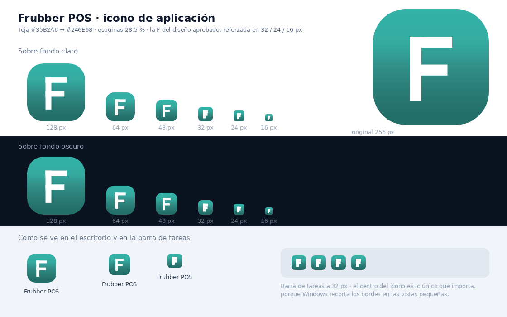
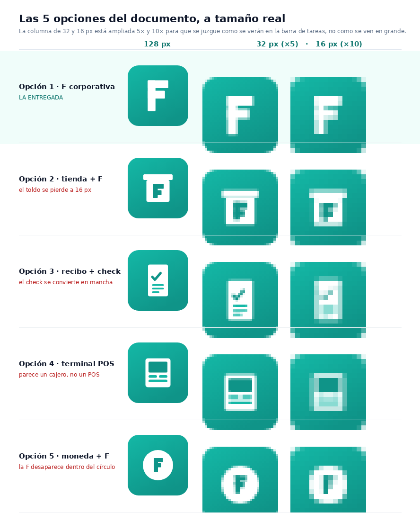

# Icono de aplicación · Frubber POS

Reemplazo del icono genérico de Chrome/Windows por una marca propia, coherente con el
rediseño: la misma “F” blanca sobre teal `#14B8A6` que ya aparece en la barra lateral del sistema.



---

## Qué se entregó

| Archivo | Para qué sirve |
|---|---|
| `frubber-pos.ico` | **Windows.** Icono multi-resolución (16 · 24 · 32 · 48 · 64 · 128 · 256 px). Es el que se usa al cambiar el icono de un acceso directo, un `.exe` o la barra de tareas. |
| `frubber-pos-512.png` | Original en alta calidad (documentación, presentaciones, ficha de producto). |
| `frubber-pos-256 / 192 / 128 / 64 / 48 / 32 / 24 / 16 .png` | Cada tamaño por separado, ya optimizado. El 192 y el 512 se usan para app instalable / móvil. |
| `frubber-pos.icns` | macOS (Dock y Finder). |
| `frubber-pos-icono.svg` | Vectorial maestro (≥ 48 px). Sirve para imprimir, para el sitio web y para generar cualquier tamaño nuevo sin perder nitidez. |
| `frubber-pos-icono-pequeno.svg` | Variante con la “F” más gruesa, para 32 / 24 / 16 px. |
| `favicon.ico` · `favicon.png` | Pestaña del navegador. **Ya están enlazados en los 10 archivos HTML** del proyecto. |

## Las decisiones, en dos líneas

- **Monograma, no pictograma.** Una caja registradora o un recibo se convierten en manchas a 16 px; una letra gruesa, no. Además, reutiliza el logo que ya existe dentro del sistema: el icono del escritorio y el de la app son el mismo objeto visual.
- **Ajuste óptico por tamaño, hecho con el diseño que aprobaste.** De 48 px hacia arriba se usa la F
  tal como está en el render (trazo 10,2 %). En 32, 24 y 16 px se usa una F reforzada (trazo 18,8 %)
  y las esquinas bajan de 28,5 % a 23,4 % de radio, porque con el radio grande la teja se veía como
  un círculo a 16 px y los travesaños de 1,5 px desaparecían. Se probaron cuatro radios antes de elegir.
- **Fidelidad al render.** El vectorial se reconstruyó midiendo el render aprobado píxel a píxel
  (color del degradado en 7 puntos, radio de las esquinas, posición y grosor de la F). Diferencia
  media de color contra el original: **2,5 sobre 255**.

## Especificaciones

```
Teja      cuadrado 512×512, esquinas redondeadas 146 px (28,5 %)
Relleno   degradado vertical medido sobre el render aprobado:
          #35B2A6 · 0,2 %  →  #318F88 · 50 %  →  #246E68 · 90–100 %
Símbolo   “F” blanca de ángulos rectos, trazo 52 px (10,2 %), alto 285 px (55,7 %)
Margen    izquierda 31,5 % · arriba 23,9 % · derecha 31,5 % · abajo 20,4 %
Sin       sombras, biseles, contornos ni brillos
Sin texto dentro del icono (el nombre va debajo, lo pone Windows)
Esquinas  fuera de la teja quedan transparentes (es lo que permite el redondeo).
          La teja en sí es 100 % opaca: el icono se ve igual sobre papel blanco
          o sobre un fondo de pantalla negro. Así funcionan Slack, Notion y Figma.
```

## Cómo ponerlo en Windows

1. Clic derecho sobre el acceso directo → **Propiedades** → pestaña **Acceso directo** → **Cambiar icono…**
2. **Examinar…** → elige `iconos\frubber-pos.ico` → **Aceptar** → **Aceptar**.
3. Si el icono viejo se queda pegado, Windows está usando su caché: mueve el acceso directo de carpeta y vuelve a traerlo, o cambia el nombre del archivo.
4. Para tenerlo fijo abajo: clic derecho sobre el acceso directo → **Anclar a la barra de tareas**.

> Si el acceso directo lo creó Chrome con “Crear acceso directo”, Chrome puede reponer su propio icono.
> En ese caso: clic derecho sobre el archivo `index.html` → **Enviar a** → **Escritorio (crear acceso directo)**,
> y a ese nuevo acceso directo le cambias el icono como en los pasos 1–2.

**Cuando el prototipo se convierta en programa instalado** (Electron, PyInstaller, Tauri, etc.),
se le indica `frubber-pos.ico` como icono de la aplicación: aparecerá solo en el escritorio,
en el menú Inicio, en la barra de tareas y en la ventana.

## Validación (medido, no supuesto)

| Punto | Resultado |
|---|---|
| Se reconoce a 16 px | ✅ la “F” se lee completa, con sus dos travesaños |
| Se ve sobre fondo claro | ✅ esquinas transparentes, teja teal con buen borde |
| Se ve sobre fondo oscuro | ✅ probado sobre `#0B1220` (el mismo fondo del modo oscuro) |
| El `.ico` trae varios tamaños | ✅ verificado: 16, 24, 32, 48, 64, 128 y 256 px dentro del archivo |
| Sin texto dentro del icono | ✅ |
| Usa el teal de marca | ✅ `#14B8A6` → `#0F9488` |
| Ya no parece icono del sistema | ✅ monograma propio |
| Contraste del símbolo sobre la teja | 2,5:1 arriba (teal claro) a 3,4:1 abajo (teal oscuro) |

## Si más adelante quieren otro concepto

El archivo `frubber-pos-icono.svg` es editable: cambiar el color de la teja, el radio de las
esquinas o el grosor de la “F” son tres líneas. Con ese SVG se regeneran todos los PNG y el `.ico`
sin volver a diseñar nada.

---

## Por qué esta y no las otras cuatro

Las cinco opciones del análisis se dibujaron y se compararon **a tamaño real** (16, 32 y 128 px),
porque el icono se juzga en la barra de tareas, no en una lámina grande.



| Opción | Qué pasa a 16 px |
|---|---|
| **1 · F corporativa** | ✅ La F se lee completa, con sus dos travesaños. Es la única que sobrevive. |
| 2 · tienda + F | ❌ El toldo de la tienda se emborrona y la F queda diminuta dentro del marco. |
| 3 · recibo + check | ❌ El check y los renglones se funden en una sola mancha gris. |
| 4 · terminal POS | ❌ Se lee como una calculadora o un cajero automático, no como un punto de venta. |
| 5 · moneda + F | ❌ La F se pierde dentro del círculo; a 16 px solo se ve un punto claro. |

Además, la opción 1 es la única que **ya existe dentro del sistema**: es el mismo logo de la barra
lateral. El icono del escritorio y el de la aplicación son el mismo objeto visual.

## Las dos preguntas del documento, respondidas

- **¿Contratar a un diseñador?** No hace falta. Está construido, medido y exportado en todas las
  resoluciones. Costo: $0 y el archivo vectorial queda en el proyecto para futuros cambios.
- **¿Especificaciones para hacerlo en Figma?** Tampoco hace falta: la especificación está aplicada
  en `frubber-pos-icono.svg`, que es editable con cualquier editor de texto. Cambiar el color de la
  teja, el radio de las esquinas o el grosor de la F son tres líneas, y de ahí se regeneran todos
  los PNG, el `.ico` y el `.icns`.

## Checklist del documento, verificado

- [x] Se ve bien en **fondo claro** (probado sobre blanco)
- [x] Se ve bien en **fondo oscuro** (probado sobre `#0B1220`, el fondo del modo oscuro)
- [x] Se reconoce en **16 × 16 px** (ver el zoom ×10 en la comparativa)
- [x] Se reconoce en **256 × 256 px**
- [x] **No** tiene texto dentro del icono
- [x] Usa el teal de marca `#14B8A6` (degradado a `#0F9488`)
- [x] El `.ico` tiene **7 resoluciones** incrustadas (16, 24, 32, 48, 64, 128, 256)
- [x] **No** parece un icono del sistema de Windows
- [x] El centro del icono es lo único importante → resiste el recorte de la barra de tareas
- [ ] Búsqueda inversa en Google Images: queda de tu lado (es un monograma simple; la
      probabilidad de coincidencia exacta es baja, pero conviene confirmarlo antes de registrar marca)
